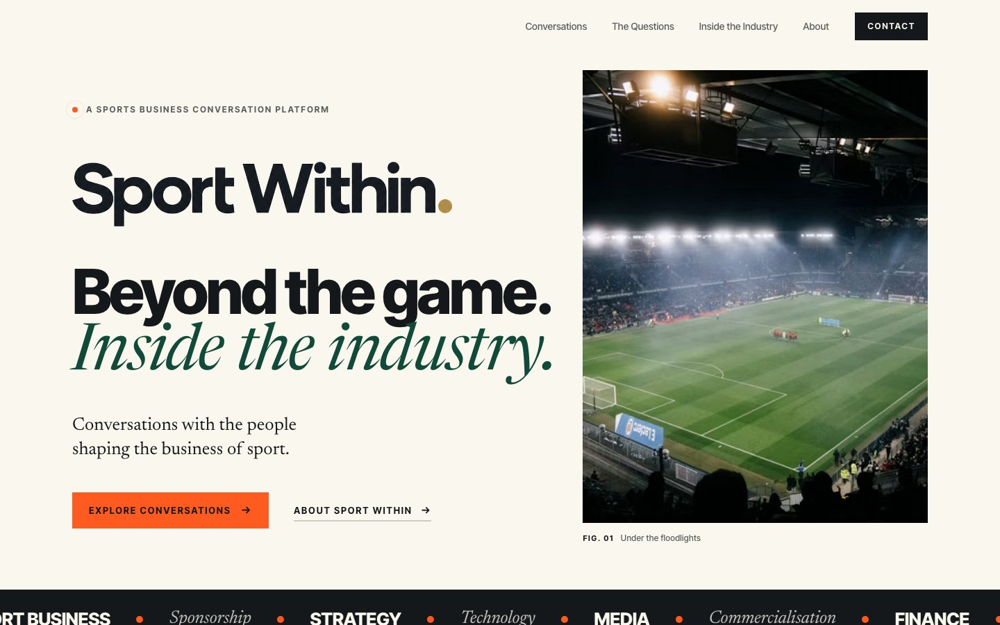
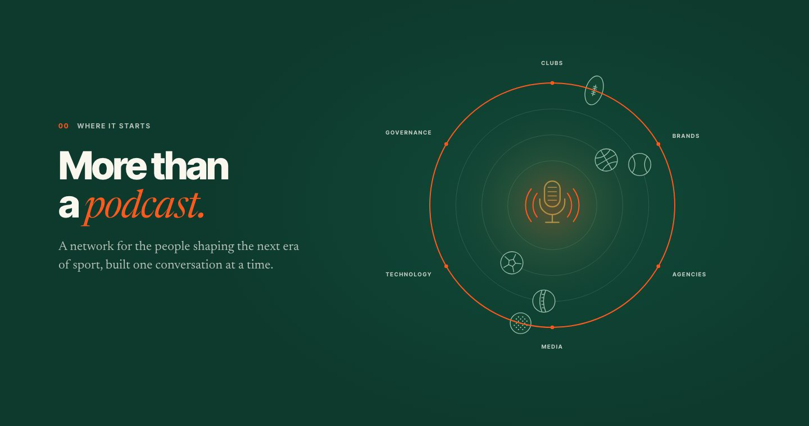

# Sport Within

**Editorial landing page for Sport Within: a conversation-led platform about the people, ideas and decisions shaping the business of sport.**




## Overview

Sport Within is a student-led platform starting with a podcast and growing towards media, a professional network and events. The site has one job: when a senior sports executive opens it from a LinkedIn invitation, they should think *"this is considered and credible"* within seconds.

It's a single page with no framework, no build step and no backend. It's fast, easy to host anywhere, and easy for a non-developer to update.

## Highlights

- **Scroll-driven story.** A microphone sits at the centre of an orbit. As you scroll, rings draw in, six sports join and rotate, the industry appears around them, and a signal-orange arc closes the circle. The message: a podcast at the core, more than a podcast around it. *(on the `orbit-redesign` branch)*
- **Editorial design system.** Inter Tight and Newsreader type, a five-colour palette (paper, ink, pitch green, signal orange, brand gold) and magazine-style section labels.
- **Content separated from layout.** Episodes, questions, industry sectors, photos and links live in [`content.js`](content.js), shaped like a headless-CMS schema. Switching an episode to `"live"` turns the "Coming soon" block into a Watch/Listen module.
- **Honest by design.** Nothing links to a page that doesn't exist yet; unfinished channels show "Soon". The roadmap marks only today's stage as live.
- **Responsive 4K photography.** Images come from Unsplash's CDN with `srcset`, from 640px on phones up to 3840px on large displays.
- **Founders section.** Co-founders Sahil Deshpande and Devvrat Bhalerao with portraits and bios, plus a "bridge" graphic showing how Sport Within connects people inside the industry with people trying to get in.
- **Production-ready.** Security headers and a strict Content Security Policy, a spam-protected contact form, a privacy notice, a 404 page, a sitemap, `security.txt` and caching rules. See [DEPLOY.md](DEPLOY.md).
- **Accessible.** Semantic headings, keyboard-friendly navigation and contact dialog, AA-contrast colours, and full support for `prefers-reduced-motion`.
- **Analytics-ready.** CTA, episode, social and contact events are sent to GA4/GTM (`dataLayer`) or Plausible if either is installed.

<p align="center"></p>

## Run locally

```bash
git clone https://github.com/ta1rc/Sport-Within.git
cd Sport-Within
python3 -m http.server 4173
```

Then open http://localhost:4173. Any static file server works, for example `npx serve .`

## Project structure

```
index.html    page structure and fixed copy
styles.css    design tokens, layout, components, motion
content.js    editable content: episodes, questions, sectors, photos, links
main.js       rendering, orbit animation, navigation, contact form, analytics
privacy.html  privacy notice (UK GDPR)
404.html      not-found page
assets/       logo, icons, founder photos, social share image
_headers      security + caching headers (Netlify, Cloudflare Pages)
vercel.json   the same headers for Vercel
scripts/      configure.sh: sets the live domain and contact email
docs/         README screenshots
```

## Updating content

Edit `content.js`, then bump the `?v=` number on the CSS/JS links in `index.html` so returning visitors get the new files.

| To change | Edit |
|---|---|
| Episode details, status, video/audio links | `episodes` |
| The five questions | `questions` |
| Industry sectors | `categories` |
| A photo | the `id` in `photos` (any Unsplash photo) |
| Social links, contact email, form endpoint | `links`, `site` |

## Deploy

No build step. Run `scripts/configure.sh https://www.yourdomain.com hello@yourdomain.com` once, then connect the repo to Cloudflare Pages or Netlify. [DEPLOY.md](DEPLOY.md) has the full steps, the security and performance setup, and the launch checklist.

## Credits

Photography by the Unsplash photographers credited in the site footer. Fonts by Google Fonts.
